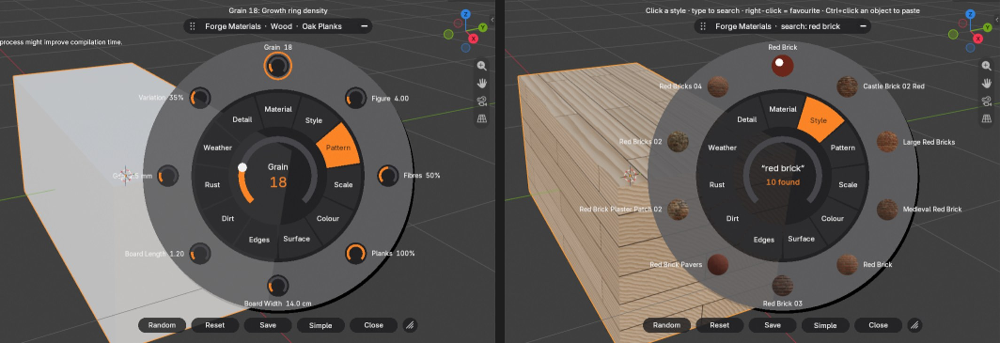
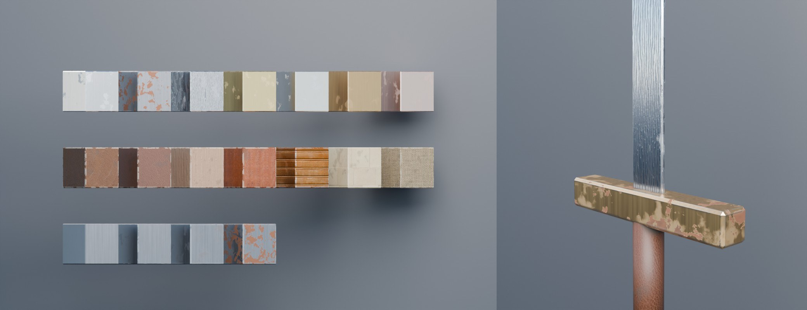
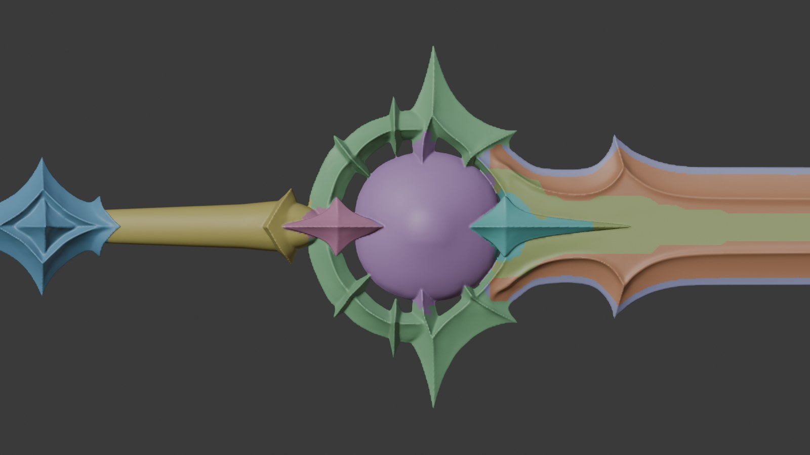

# Forge Materials

A Blender add-on (4.2 or newer, tested on 5.2) for texturing models from your
own PBR library, splitting them into material regions, weathering them and
baking game-ready textures.

**The add-on never changes geometry or UVs.** It only writes material slots,
the material index of each face and a few custom properties. Baking, export and
AI Hybrid Parts work on temporary copies.

## Install

1. Download `forge_materials-<version>.zip` from the Releases page (do not unzip it).
2. Blender: *Edit > Preferences > Get Extensions > ⌄ > Install from Disk*, pick the zip.
3. In the add-on preferences set **Texture Library** to your PBR folder and
   press **Scan Library**.

### Free materials

No textures are included. Download free PBR materials from
**[Poly Haven](https://polyhaven.com/textures)**: every asset there is CC0
(free for any use, including commercial, no credit needed). Unzip each
material into its own folder inside your library, then press **Scan
Library**. Poly Haven's file names (`_diff`, `_nor_gl`, `_rough`, `_arm` ...)
are recognised as they are.

The panel is in *3D Viewport > Sidebar (N) > Forge Materials*. The dial opens
with **Ctrl+Alt+D**.



## Features

### Materials
- **Texture library:** any folder of PBR materials (Poly Haven layout, or one
  folder per material), sorted into categories, with search and favourites.
- **24 procedural materials** (no image files): wood planks, brick and stone,
  tiles, concrete and plaster, cloth, and metals (polished steel, dark iron,
  damascus, gold, silver, bronze, copper).
- **Real-world scale:** Size ×1 is the real size (a brick is 21.5 cm). Wood
  grain and metal brushing follow the object's long axis.
- **Weathering layers** over any material: edge wear, dirt, rust, peeling
  paint, moss, wetness and puddles, snow.
- **The dial (Ctrl+Alt+D):** material, style, pattern, scale, colour, surface,
  edges, dirt, rust, weather, detail. Type to search; right-click a material to
  favourite it; **Save** stores a complete look.



### Smart Regions
Splits a mesh into material regions without touching the mesh.

- **Auto: By Shape** for long objects (swords, tools, spears): splits where the
  width changes along the length. **At Creases** for any object.
- Options: guard sub-parts, grip ferrules, blade fuller, blade edge strip,
  faces buried inside another part.
- **Smart Regions (click to refine):** click, double-click (whole part),
  mirror selection, select similar pieces, lasso, merge, split, rename, undo.
  Shortcuts are shown in the viewport.
- **Suggest Materials** proposes a material per region.



### AI Hybrid Parts (optional, experimental)
Renders every part on its own and lets SAM 2 propose sub-parts; borders still
follow the mesh creases. It runs in the background on a saved copy (5-30 min
on a 4 GB GPU) and needs a separate Python environment (see below).

### Baking and export
- Bake BaseColor, Roughness, Metallic, ORM, Normal (OpenGL and DirectX), AO
  and Height up to 8K, directly or in a background process (Cycles).
- **Export Game Pack** with each engine's naming: Unreal (`T_Asset_BC`,
  `T_Asset_N`, `T_Asset_ORM` + FBX), Unity (Albedo, Normal,
  MetallicSmoothness, AO + FBX), Godot, or generic.
- Texel density check with a warning when parts differ by more than 25%.

## Known limitations

Measured on 11 test swords (3 generated, 8 real models):

- Auto Regions finds the large parts well (blade, guard, grip, pommel: 86-97%
  of the area on the right part for 8 of the 11 swords), but it does **not**
  separate small parts: gems, pearls, rings, spikes and ferrules end up inside
  the part next to them.
- It fails on strongly curved blades (regions are found but not named) and on
  models sliced into many objects. It works on the active object only.
- Borders between parts are often placed 2-5 mm from the real seam.
- AI Hybrid Parts did not improve these results in the tests: it adds unnamed
  sub-parts, takes 8 to 79 times longer and uses about 3 GB of GPU memory.
- Objects without UVs are refused by the baker (no automatic unwrap).
- Edge wear shows in Cycles; baking always uses Cycles.

## AI Hybrid Parts setup (optional)

1. Create a Python 3.10+ environment in a folder, for example `fm_ai`, with a
   `venv` inside it:
   ```
   python -m venv fm_ai/venv
   fm_ai/venv/Scripts/python -m pip install -r ai/requirements.txt   (Windows)
   fm_ai/venv/bin/python -m pip install -r ai/requirements.txt       (Linux, macOS)
   ```
   Install PyTorch for your GPU first ([pytorch.org](https://pytorch.org/get-started/locally/)).
2. Download the SAM 2.1 small checkpoint
   ([sam2.1_hiera_small.pt](https://dl.fbaipublicfiles.com/segment_anything_2/092824/sam2.1_hiera_small.pt))
   into `fm_ai/checkpoints/`.
3. In the add-on preferences set **AI Environment** to the `fm_ai` folder.

SAM 2 is made by Meta and released under the Apache 2.0 license
([facebookresearch/sam2](https://github.com/facebookresearch/sam2)). It is not
included here; you download it yourself.

## License

GPL-3.0-or-later, see [LICENSE](LICENSE). Changes are listed in
[CHANGELOG.md](CHANGELOG.md).
